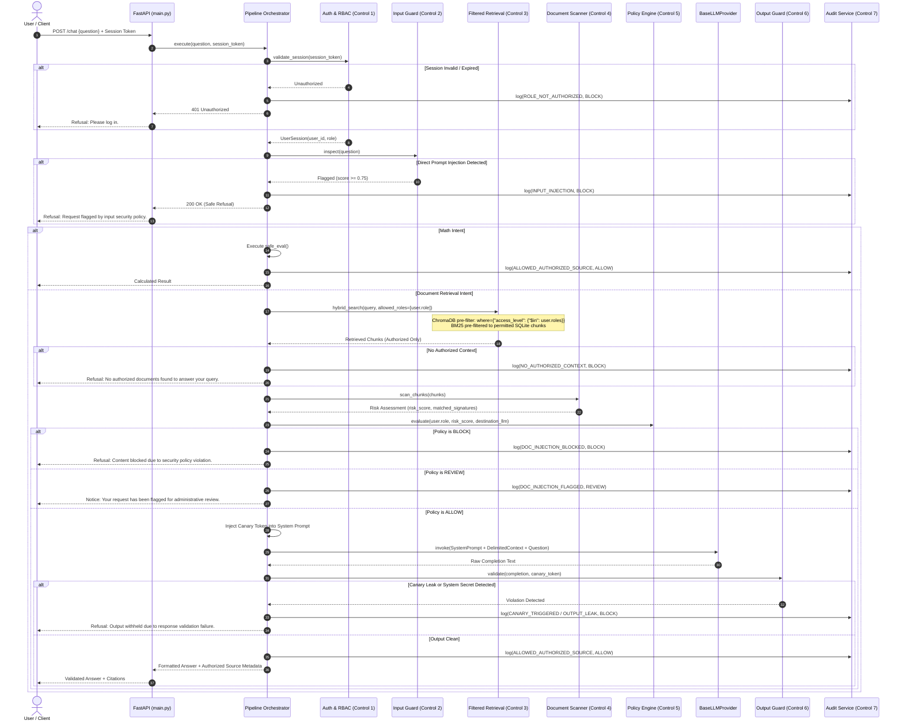
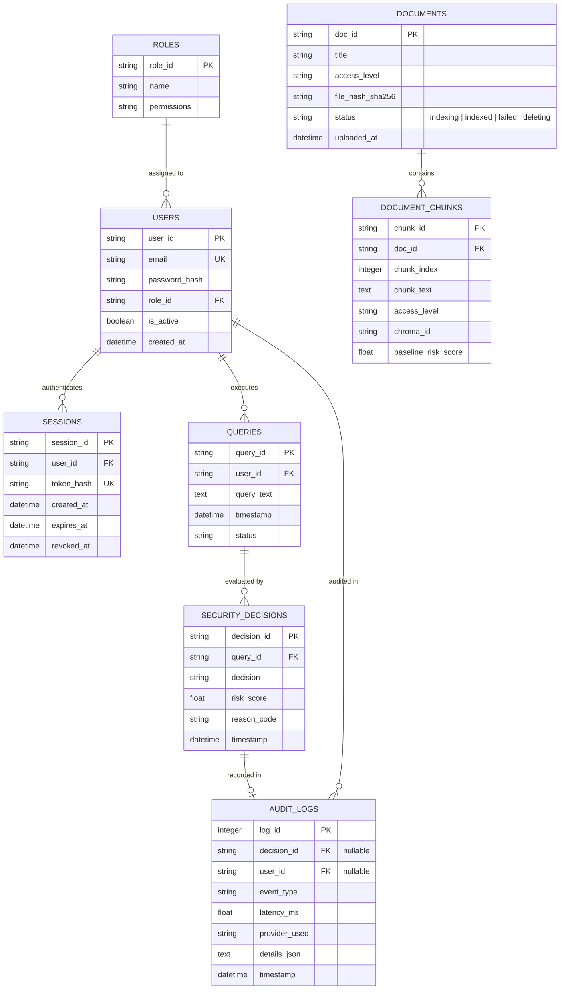

# Architecture Specification: Secure RAG Platform (Nexus AI Engine Upgrade)

**Document Status:** APPROVED — ACTIVE SPECIFICATION (Decisions D1–D18 Frozen)  
**Author:** Senior RAG Architect & AI Security Engineer  
**Date:** 2026-10-18 (Updated 2026-11-13)  
**Target Specification:** `Secure_RAG_Executive_Blueprint.docx` (17 October 2026)  
**Baseline System:** Nexus AI Engine (`d:\nexys`)

> **Implementation Status (2026-11-13):**  
> The production layout uses `api/app.py` as the FastAPI application factory (TASK-07)
> with all dependency injection centralized in `src/secure_rag/bootstrap.py`.
> `main.py` is a thin entry point that calls `bootstrap.create_application()`.
> Intent classification lives in `src/secure_rag/routing/intent.py` (shared by both the
> secure pipeline and the legacy agent path). Legacy in-memory retrieval components
> (`NumpyFlatL2`, `HybridMemoryStore`) are relocated to `agent/_legacy/` with thin
> re-export shims at their original paths for backward compatibility.

---

## 1. Purpose and Scope

### 1.1 Purpose
This document defines the authoritative, binding target architecture for upgrading the **Nexus AI Engine** from an experimental, unauthenticated, in-memory tool into the **Secure RAG Platform**. It defines module responsibilities, strict trust boundaries, enforcement points for 7 security controls, unified data schemas, and interface contracts. 

Implementation will proceed strictly task-by-task based on this document. No code change may contradict this specification without an explicit, recorded architectural amendment.

### 1.2 Scope
- **In Scope:**
  - Multi-role access control (`Employee`, `HR`, `Admin`) with deny-by-default retrieval filtering.
  - Dual-store architecture: SQLite as the authoritative source of relational truth and permissions; ChromaDB as the vector index.
  - Hybrid retrieval: Metadata-filtered semantic search (ChromaDB) + metadata-filtered lexical search (BM25) with Reciprocal Rank Fusion (RRF).
  - Rule-based document scanner inspecting retrieved chunks for indirect prompt injection.
  - Centralized policy engine adjudicating `ALLOW`, `REVIEW`, and `BLOCK` decisions with explicit reason codes.
  - Pluggable LLM provider abstraction: Local Ollama (`llama3.1:8b`) by default; Groq cloud fallback chain as an optional, privacy-governed provider.
  - AST-safe calculator and policy-governed, untrusted web search (disabled by default).
  - Output guard enforcing canary-token checks and regex leak prevention.
  - Append-only audit logging in SQLite capturing 100% of requests, decisions, and reason codes.
  - Headless FastAPI service as the single pipeline engine; Streamlit as a thin client.
  - Automated evaluation harness comparing `SECURITY_MODE=baseline` vs. `SECURITY_MODE=enhanced`.
- **Out of Scope:**
  - Production enterprise SSO (SAML/OIDC) integration (local bcrypt authentication and session tokens are used).
  - Multi-tenant cloud hosting and Kubernetes orchestration.
  - Training or fine-tuning proprietary foundation models.
  - Real confidential corporate data (fictional Northwind Retail dataset only).

---

## 2. Decision Log (ADR-Style)

All architectural decisions recorded here supersede previous documentation and are binding across all implementation phases.

### Decision Log Summary (D1 – D12)

| Decision ID | Topic | Decision | Status | Date |
| :--- | :--- | :--- | :--- | :--- |
| **D1** | **LLM Provider** | Implement `BaseLLMProvider`. Default to **Local Ollama** (`llama3.1:8b`). Groq cloud fallback chain is retained as an optional secondary provider (`LLM_PROVIDER=groq`). **Enforcement rule:** When Groq is active, all requests are tagged as `external-LLM` in audit logs, and any chunk with an access level above `employee` (e.g. `hr`) is strictly prohibited from being sent to Groq. | **APPROVED** | 2026-10-18 |
| **D2** | **Storage Architecture** | Deploy **ChromaDB** for vector storage with native metadata filtering (`filter-before-search`). Deploy **SQLite** as the single relational authority for users, roles, documents, chunks, queries, decisions, and audit logs. Rebuild BM25 dynamically from authorized SQLite chunks per query scope. Remove `NumpyFlatL2`. Correct `README.md` claims regarding FAISS. | **APPROVED** | 2026-10-18 |
| **D3** | **Tool Governance** | Retain the AST-safe calculator tool. Retain DuckDuckGo web search, but set **OFF by default** (`ENABLE_WEB_SEARCH=false`). Treat all web search output as untrusted external content that must pass through the Document Scanner and Output Guard. Web search results must **never** be co-mingled with restricted document chunks in a single prompt. | **APPROVED** | 2026-10-18 |
| **D4** | **Auth & Roles** | Implement full RBAC (`Employee`, `HR`, `Admin`) with `bcrypt` password hashing and session expiration. In `APP_ENV=dev`, seed deterministic demo accounts (`employee@northwind.local`, `hr@northwind.local`, `admin@northwind.local`). Admin role is granted access to operational dashboards and audit logs, but is strictly prohibited from viewing raw document text or chunk content. | **APPROVED** | 2026-10-18 |
| **D5** | **API Key & Secrets** | Strip `api_key` parameter entirely from `/chat` request payload. Remove all process-level environment mutations (`os.environ["GROQ_API_KEY"] = ...`). All provider credentials must be loaded exclusively from server-side environment configuration (`.env`) at startup and never exposed in client responses or audit logs. | **APPROVED** | 2026-10-18 |
| **D6** | **Dependency Pinning** | Strictly pin all dependencies in `requirements.txt` using exact equality (`==`). Retain a single authoritative requirements manifest accompanied by a lock verification step. Pin only versions confirmed in installed environments. Unverified packages must be flagged explicitly. | **APPROVED** | 2026-10-18 |
| **D7** | **Single Backend Service** | Establish **FastAPI (`main.py`)** as the sole pipeline execution engine. Refactor **Streamlit (`app.py`)** into a thin presentation client communicating with FastAPI over HTTP. Completely eliminate duplicate in-memory `RAGSystem` instances in Streamlit `session_state`. | **APPROVED** | 2026-10-18 |
| **D8** | **Test Modernization** | Migrate procedural assertions in `qa_test_suite.py` into structured `pytest` suites: `tests/unit`, `tests/integration`, and `tests/security`. Retain all existing calculator, intent classification, and document parsing cases as regression baselines. | **APPROVED** | 2026-10-18 |
| **D9** | **Server-Side Sessions** | Implement server-side sessions backed by the `sessions` table. Session tokens generated using `secrets.token_urlsafe(32)`; only their SHA-256 hash is persisted in the database. Raw tokens are never stored, logged, or exposed in audit trails. Logout explicitly revokes sessions via `revoked_at`. Inactivity timeout governed by `SESSION_TIMEOUT_MIN`. | **APPROVED** | 2026-10-18 |
| **D10** | **Database Authority on Every Request** | On EVERY request, the session token is validated against the database, and the user's current `is_active` status and role are read directly from SQLite. Never trust cached client claims or roles encoded in tokens. | **APPROVED** | 2026-10-18 |
| **D11** | **Role-to-Access-Level Mapping** | Define single authoritative mapping in `constants.py`: `employee -> ["employee"]`, `hr -> ["employee", "hr"]`, `admin -> []` (no document retrieval). Admin can view audit dashboards, but all document retrieval queries by Admin are denied by default and audited. | **APPROVED** | 2026-10-18 |
| **D12** | **Password Policy & Timing-Safe bcrypt** | Enforce password length: minimum 12 characters, maximum 72 bytes (explicitly rejecting >72 bytes with a clear validation error to adhere cleanly to bcrypt native limits). Login failures return a generic error message ("Invalid email or password"). For unknown emails, run a dummy bcrypt check to mitigate timing side-channel attacks. Implement rate-limiting throttling (`RATE_LIMITED`) after repeated failed attempts. | **APPROVED** | 2026-10-18 |
| **D13** | **Ingestion Access Control (HR Only)** | Only users with the `HR` role are authorized to upload, ingest, or delete documents (`can_ingest(role)`). The uploader selects the access level (`employee` or `hr`), which must reside within the uploader's permitted levels. Any attempt by unauthorized roles is rejected with `AuthorizationError` and logged to audit trails. | **APPROVED** | 2026-10-18 |
| **D14** | **ChromaDB Vector Store & Text Exclusion** | ChromaDB holds dense vectors and minimal metadata (`chunk_id`, `doc_id`, `access_level`) only. **NO chunk text is stored in ChromaDB**; chunk text is stored exclusively in SQLite `document_chunks`. `retrieval/vector_store.py` is the sole module importing `chromadb`. Telemetry is disabled (`anonymized_telemetry=False`). Distance metric is cosine space (`hnsw:space: cosine`). Queries require `allowed_access_levels`; an empty access list returns `[]` immediately without querying Chroma. | **APPROVED** | 2026-10-18 |
| **D15** | **Deterministic Chunking & Embeddings Abstraction** | Deterministic boundary-aware chunking (`CHUNK_SIZE=600`, `CHUNK_OVERLAP=80`) preserving sentence and paragraph structures. Embeddings are encapsulated in `retrieval/embeddings.py` using `SentenceTransformer` (`all-MiniLM-L6-v2`, 384 dimensions, normalized). Dependency injection provides `FakeEmbedder` for deterministic millisecond unit tests; exactly one integration test marked `@pytest.mark.slow` verifies real model loading and vector normalization. | **APPROVED** | 2026-10-18 |
| **D16** | **Deduplication by SHA-256 Hash** | Documents are deduplicated by their SHA-256 file content hash. Ingesting an identical hash under the same access level is idempotent (returns existing record without duplicate chunks/vectors). Ingesting an identical hash under a conflicting access level is rejected as a potential classification conflict / data poisoning attempt, raising `DuplicateDocumentError` and logging `data_poisoning_attempt`. | **APPROVED** | 2026-10-18 |
| **D17** | **In-Memory Multi-Format Parsing & Safeguards** | Parsers for `.pdf`, `.docx`, `.txt` operate strictly in memory via `io.BytesIO`. Magic bytes are verified (`%PDF-`, `PK\x03\x04` with OOXML package verification). Zip-bomb mitigations enforce maximum uncompressed size (20 MB) and compression ratio (100:1) on DOCX files. Encrypted/password-protected PDFs are rejected. Upload limits enforced (`MAX_UPLOAD_MB=10`, `MAX_PAGES=100`, `MAX_TEXT_CHARS=500000`, `MAX_CHUNKS=1000`). Invisible Unicode characters (zero-width spaces, bidirectional overrides) are never stripped so security scanners in TASK-05 can inspect raw payloads. | **APPROVED** | 2026-10-18 |
| **D18** | **Transactional Ingestion & Consistency Verification** | Strict write ordering: (1) SQLite document status `indexing` + chunks inserted; (2) Vectors added to ChromaDB; (3) SQLite document status updated to `indexed`. On failure, Chroma vectors for the document are purged and SQLite document status is marked `failed`. `verify_index_consistency()` provides an authoritative operational audit cross-referencing SQLite chunks against Chroma vector IDs. | **APPROVED** | 2026-10-18 |

---

## 3. Current-State Summary & Technical Debt Audit

The baseline Nexus codebase (`d:\nexys`) operates as an experimental prototype with substantial architectural debt and security vulnerabilities:
1. **State Fragmentation:** `app.py` directly instantiates `RAGSystem()` inside `st.session_state.rag`. Concurrently, `main.py` instantiates an independent global singleton `rag = RAGSystem()`. Files uploaded through the UI are invisible to the REST API, and vice-versa.
2. **Missing Persistence:** Document chunks, embeddings, and BM25 indices are stored exclusively in volatile memory (`self.chunks = []`, `NumpyFlatL2`). All indices vanish upon process termination.
3. **Absence of Access Control:** All indexed documents are globally retrievable. There is no concept of users, sessions, or sensitivity tiers.
4. **Environment Race Conditions:** In `main.py:34`, client-supplied API keys overwrite `os.environ["GROQ_API_KEY"]` at runtime, creating a critical race condition across concurrent requests.
5. **False Documentation Claims:** Documentation asserts the use of FAISS; the code actually executes Euclidean distances over raw NumPy arrays (`NumpyFlatL2`). Documentation asserts `pytest tests/ -v`; tests actually reside in a procedural script `qa_test_suite.py`.
6. **Vulnerability to Injection:** Retrieved document passages are interpolated directly into prompt templates with no sanitization, structural isolation, or Canary verification.

---

## 4. Target Architecture & Module Layout

The codebase is organized into a modular domain architecture under `src/secure_rag/`, eliminating circular dependencies and separating concerns.

```
nexus-secure-rag/
├── .env.example                      # Complete environment configuration template
├── requirements.txt                  # Pinned production and security dependencies
├── README.md                         # Authoritative project documentation
├── main.py                           # FastAPI application entry point & routes
├── app.py                            # Streamlit thin client UI
├── config/
│   ├── policy.yaml                   # Risk score thresholds and role permissions
│   ├── injection_rules.yaml          # Regex and keyword signatures for scanner
│   └── logging.yaml                  # Structured logging and audit format rules
├── data/
│   ├── secure_rag.db                 # Authoritative SQLite database
│   ├── chroma/                       # Persistent ChromaDB vector storage
│   ├── raw/                          # Fictional Northwind documents
│   │   ├── employee/                 # General employee handbook, policies
│   │   ├── hr/                       # Restricted payroll, executive compensation
│   │   └── poisoned/                 # Indirect prompt injection test documents
│   └── test_cases/                   # Benchmark attack & benign query sets
├── src/
│   └── secure_rag/
│       ├── __init__.py
│       ├── core/
│       │   ├── config.py             # Typed dataclass application settings (B10)
│       │   └── errors.py             # Custom domain exception taxonomy
│       ├── db/
│       │   ├── constants.py          # Authoritative schema version (SCHEMA_VERSION = 3) (B7)
│       │   ├── connection.py         # Thread-safe SQLite connection factory & compatibility
│       │   ├── schema.sql            # DDL for users, roles, docs, audit tables, triggers
│       │   └── repository.py         # Data Access Object (DAO) with status gating & ACID
│       ├── auth/
│       │   ├── constants.py          # Authoritative ROLE_ACCESS_MAPPING, password limits, bcrypt rounds
│       │   ├── security.py           # Password hashing (bcrypt) & token creation
│       │   └── service.py            # User login, session validation, RBAC checks
│       ├── ingestion/
│       │   ├── parsers.py            # In-memory PDF, DOCX, TXT extractors with zip-bomb defense
│       │   ├── chunker.py            # Boundary-aware sentence chunker with overlap
│       │   └── pipeline.py           # Ingestion orchestrator: parse -> tag -> SQLite -> ChromaDB (decoupled from auth)
│       ├── retrieval/
│       │   ├── embeddings.py         # SentenceTransformer wrapper
│       │   ├── vector_store.py       # ChromaDB client with pre-filtering
│       │   ├── keyword_search.py     # Filtered BM25 lexical engine
│       │   └── hybrid_engine.py      # Reciprocal Rank Fusion (RRF) combiner
│       ├── security/
│       │   ├── input_guard.py        # Direct injection & syntax validation
│       │   ├── scanner.py            # Rule-based indirect injection detector
│       │   ├── policy_engine.py      # Allow/Review/Block risk adjudicator
│       │   ├── prompt_builder.py     # System/Context/User delimiter isolation
│       │   └── output_guard.py       # Canary detector & sensitive data sanitizer
│       ├── tools/
│       │   ├── calculator.py         # AST-safe deterministic math evaluator
│       │   └── web_search.py         # Policy-governed DuckDuckGo client
│       ├── llm/
│       │   ├── base.py               # BaseLLMProvider abstract contract
│       │   ├── ollama_provider.py    # Local Ollama client (default)
│       │   ├── groq_provider.py      # Groq cloud fallback chain (optional)
│       │   └── factory.py            # Provider factory based on LLM_PROVIDER
│       ├── audit/
│       │   └── service.py            # Append-only SQLite audit log writer
│       └── pipeline.py               # Master Orchestrator: End-to-end request lifecycle
├── dashboard/
│   ├── overview.py                   # System status & metrics
│   ├── audit_viewer.py               # Searchable audit log inspector
│   └── review_queue.py               # Human-in-the-loop review interface
├── evaluation/
│   ├── run_eval.py                   # Automated benchmark runner (baseline vs enhanced)
│   ├── metrics.py                    # Attack success, leak rate, false positive calculators
│   └── results/                      # Output benchmark reports and artifacts
└── tests/
    ├── conftest.py                   # Shared fixtures, test DB, mock LLMs
    ├── unit/                         # Unit tests (AST, chunker, parsers, rules)
    ├── integration/                  # Integration tests (Ingestion -> DB, Auth -> API)
    └── security/                     # Adversarial attacks, role bypass, canary leaks
```

---

## 5. Module Responsibilities & Dependency Map

### 5.1 Responsibility Matrix

| Module | Exact Responsibility | Forbidden Operations |
| :--- | :--- | :--- |
| `auth/` | Authenticate credentials via `bcrypt`; issue/validate session tokens; resolve user roles. | Cannot query document contents or access ChromaDB. |
| `db/` | Manage SQLite tables; execute parameterized queries; provide ACID guarantees for audit logs. | Cannot execute business logic, vector operations, or prompt formatting. |
| `ingestion/` | Parse uploaded files; split into chunks; record chunk records in SQLite; insert embeddings into ChromaDB with `access_level` metadata. | Cannot accept unauthenticated files or assign roles without verification. |
| `retrieval/` | Execute pre-filtered vector search in ChromaDB and pre-filtered BM25 search; fuse ranks via RRF. | Cannot retrieve any chunk whose `access_level` is not explicitly permitted for the user. |
| `security/scanner.py` | Calculate an explainable risk score $[0.0, 1.0]$ based on regex, structural anomalies, and instruction-override heuristics. | Cannot make final Allow/Block decisions. |
| `security/policy_engine.py` | Evaluate risk score, user role, and provider destination against `config/policy.yaml`; produce `ALLOW`, `REVIEW`, or `BLOCK` with reason code. | Cannot generate text or invoke the LLM. |
| `security/prompt_builder.py` | Construct prompt separating system directives, untrusted context, and user query using strict demarcation tags; inject session Canary token. | Cannot invoke LLM or execute string concatenation without escaping. |
| `security/output_guard.py` | Inspect raw LLM completion for Canary token leakage, system-prompt disclosure, and regex-matched sensitive patterns. | Cannot alter audit records or bypass refusal responses. |
| `audit/` | Write immutable, append-only logs for every query, decision, risk score, reason code, and latency measurement to SQLite. | Cannot delete or truncate records. Cannot write secrets or raw passwords. |
| `llm/` | Abstract model execution. Default to Ollama. Prohibit transmission of restricted chunks if configured to Groq. | Cannot bypass the policy engine or output guard. |
| `pipeline.py` | Coordinate the 7 controls in linear order. Manage fail-closed exceptions. | Cannot contain inline security rules (must delegate to specialized security modules). |

### 5.2 Dependency Direction & Cycle-Free Guarantee
Dependencies flow strictly in one direction:
`Clients (app.py / REST)` ➔ `main.py` ➔ `pipeline.py` ➔ `[auth, retrieval, security, llm, tools, audit]` ➔ `db`

```
main.py (FastAPI Routes)
  │
  ▼
secure_rag.pipeline (PipelineOrchestrator)
  ├──> auth.service
  ├──> retrieval.hybrid_engine
  │      ├──> retrieval.vector_store (ChromaDB)
  │      └──> retrieval.keyword_search (BM25)
  ├──> security.input_guard
  ├──> security.scanner
  ├──> security.policy_engine
  ├──> security.prompt_builder
  ├──> tools.calculator
  ├──> tools.web_search
  ├──> llm.factory ──> [ollama_provider | groq_provider]
  ├──> security.output_guard
  └──> audit.service
         └──> db.repository ──> db.connection (SQLite)
```

**Circular Dependency Statement:**  
There are zero circular dependencies. Modules in `security/` do not import `pipeline.py`. Modules in `retrieval/` do not import `llm/`. Modules in `llm/` do not import `security/`. Low-level utilities (`core/`, `db/`) depend solely on Python standard libraries and external packages.

---

## 6. End-to-End Request Pipeline & 7 Security Controls

Every incoming query traverses seven deterministic controls. If any control fails, the pipeline transitions to a recorded refusal path; it never fails open.



### Detailed Control Enforcement Specifications

| Stage | Control ID & Name | Enforcement Point | Logic & Failure Action | Resulting Reason Code |
| :--- | :--- | :--- | :--- | :--- |
| **Pre-Search** | **Control 1: Authentication & Session Verification** | `auth/service.py` | Verify session token expiry and signature. Resolve user ID and assigned role (`Employee`, `HR`, `Admin`). If invalid, fail immediately. | `ROLE_NOT_AUTHORIZED` |
| **Pre-Search** | **Control 2: Input Guard** | `security/input_guard.py` | Inspect query for delimiter injection (`<system>`, `[INST]`), command phrases ("ignore previous instructions"), and abnormal length (> 1000 chars). Reject if malicious. | `INPUT_INJECTION` |
| **Search** | **Control 3: Pre-Retrieval Access Filter** | `retrieval/vector_store.py` & `keyword_search.py` | Query ChromaDB using explicit metadata clause: `where={"access_level": {"$in": permitted_levels}}`. Filter BM25 corpus to authorized document chunks before calculating BM25 scores. Zero unauthorized chunks can be retrieved. | `ROLE_NOT_AUTHORIZED` / `NO_AUTHORIZED_CONTEXT` |
| **Post-Search** | **Control 4: Document Security Scanner** | `security/scanner.py` | Inspect text of all retrieved chunks against `injection_rules.yaml` (encoded payloads, role-override patterns, exfiltration syntax). Compute normalized risk score $S \in [0.0, 1.0]$. | `DOC_INJECTION_FLAGGED` |
| **Decision** | **Control 5: Centralized Policy Engine** | `security/policy_engine.py` | Compare $S$ against thresholds (`RISK_THRESHOLD_REVIEW=0.40`, `RISK_THRESHOLD_BLOCK=0.75`). If destination is Groq, verify that no chunk has `access_level: hr`. Output deterministic decision: `ALLOW`, `REVIEW`, or `BLOCK`. | `DOC_INJECTION_BLOCKED`, `POLICY_VIOLATION`, `ALLOWED_AUTHORIZED_SOURCE` |
| **Post-Generation** | **Control 6: Output Guard** | `security/output_guard.py` | Verify that the unique runtime `CANARY_TOKEN` is **absent** from LLM output. Verify that system prompt secrets and regex patterns (API keys, SSNs) are absent. If found, discard answer and return a safe refusal. | `CANARY_TRIGGERED`, `OUTPUT_LEAK` |
| **All Stages** | **Control 7: Append-Only Audit Logging** | `audit/service.py` | Write synchronous audit entry to SQLite `audit_logs` and `security_decisions` tables. Every request is recorded with request ID, timestamp, user ID, role, decision, reason code, and latency. | All Reason Codes |

---

## 7. Interfaces & Contract Specifications

### 7.1 Policy Engine Contract
```python
from dataclasses import dataclass
from enum import Enum
from typing import List, Optional

class DecisionOutcome(str, Enum):
    ALLOW = "ALLOW"
    REVIEW = "REVIEW"
    BLOCK = "BLOCK"

class ReasonCode(str, Enum):
    ROLE_NOT_AUTHORIZED = "ROLE_NOT_AUTHORIZED"
    INPUT_INJECTION = "INPUT_INJECTION"
    DOC_INJECTION_FLAGGED = "DOC_INJECTION_FLAGGED"
    DOC_INJECTION_BLOCKED = "DOC_INJECTION_BLOCKED"
    OUTPUT_LEAK = "OUTPUT_LEAK"
    CANARY_TRIGGERED = "CANARY_TRIGGERED"
    POLICY_VIOLATION = "POLICY_VIOLATION"
    NO_AUTHORIZED_CONTEXT = "NO_AUTHORIZED_CONTEXT"
    RATE_LIMITED = "RATE_LIMITED"
    ALLOWED_AUTHORIZED_SOURCE = "ALLOWED_AUTHORIZED_SOURCE"

@dataclass(frozen=True)
class PolicyEvaluationResult:
    decision: DecisionOutcome
    reason_code: ReasonCode
    risk_score: float
    details: str

class IPolicyEngine:
    def evaluate_request(
        self,
        user_role: str,
        query: str,
        retrieved_chunks: List[dict],
        risk_score: float,
        target_llm_provider: str,
    ) -> PolicyEvaluationResult:
        """
        Applies deterministic policy rules to decide if request proceeds to generation.
        Enforces Decision D1: Chunks with access_level != 'employee' can NEVER be sent to Groq.
        """
        ...
```

### 7.2 LLM Provider Abstraction
```python
from abc import ABC, abstractmethod
from typing import Optional

class BaseLLMProvider(ABC):
    @property
    @abstractmethod
    def provider_name(self) -> str:
        """Returns provider identifier: 'ollama' or 'groq'."""
        ...

    @abstractmethod
    def generate(self, prompt: str, temperature: float = 0.2) -> str:
        """
        Executes completion against the underlying model.
        Raises LLMProviderError on communication failure.
        """
        ...

    @abstractmethod
    def is_available(self) -> bool:
        """Health check verifying provider responsiveness."""
        ...
```

### 7.3 Hybrid Retrieval Engine Contract
```python
@dataclass(frozen=True)
class RetrievedChunk:
    chunk_id: str
    doc_id: str
    text: str
    source_file: str
    source_id: str
    access_level: str
    dense_score: float
    sparse_score: float
    fused_score: float

class IRetrievalEngine:
    def retrieve(
        self,
        query: str,
        user_role: str,
        top_k: int = 5
    ) -> List[RetrievedChunk]:
        """
        Executes pre-filtered dense vector search and pre-filtered sparse BM25 search.
        Merges results using Reciprocal Rank Fusion (RRF).
        Guarantees that no chunk where access_level not in permitted_roles(user_role) is returned.
        """
        ...
```

### 7.4 Audit Service Contract
```python
class IAuditService:
    def record_event(
        self,
        request_id: str,
        user_id: str,
        user_role: str,
        query_text: str,
        decision: DecisionOutcome,
        reason_code: ReasonCode,
        risk_score: float,
        chunks_retrieved_count: int,
        latency_ms: float,
        provider_used: str,
        details: Optional[dict] = None
    ) -> str:
        """
        Atomically appends record to SQLite audit_logs and security_decisions.
        Guarantees: No secrets, passwords, or Canary tokens are recorded.
        """
        ...
```

---

## 8. Authoritative Data Model (SQLite)

The relational database (`data/secure_rag.db`) is the sole trusted authority for identity, document status, permissions, and audit logs. The vector store holds only searchable text and embeddings.



### Database Schema DDL (`src/secure_rag/db/schema.sql`)
```sql
-- src/secure_rag/db/schema.sql
-- Authoritative Relational Schema for Secure RAG Platform (SQLite)
-- Enforces referential integrity, cascading chunk cleanup, and indexed queries.

PRAGMA foreign_keys = ON;

CREATE TABLE IF NOT EXISTS roles (
    role_id TEXT PRIMARY KEY,
    name TEXT UNIQUE NOT NULL,
    permissions TEXT NOT NULL
);

CREATE TABLE IF NOT EXISTS users (
    user_id TEXT PRIMARY KEY,
    email TEXT UNIQUE NOT NULL,
    password_hash TEXT NOT NULL,
    role_id TEXT NOT NULL REFERENCES roles(role_id),
    is_active INTEGER NOT NULL DEFAULT 1,
    created_at TIMESTAMP DEFAULT CURRENT_TIMESTAMP
);

CREATE TABLE IF NOT EXISTS documents (
    doc_id TEXT PRIMARY KEY,
    title TEXT NOT NULL,
    access_level TEXT NOT NULL, -- 'employee' or 'hr'
    file_hash_sha256 TEXT NOT NULL,
    status TEXT NOT NULL,       -- 'indexing', 'indexed', 'failed', 'deleting'
    uploaded_at TIMESTAMP DEFAULT CURRENT_TIMESTAMP
);

CREATE TABLE IF NOT EXISTS document_chunks (
    chunk_id TEXT PRIMARY KEY,
    doc_id TEXT NOT NULL REFERENCES documents(doc_id) ON DELETE CASCADE,
    chunk_index INTEGER NOT NULL,
    chunk_text TEXT NOT NULL,
    access_level TEXT NOT NULL,
    chroma_id TEXT NOT NULL,
    baseline_risk_score REAL DEFAULT 0.0
);

CREATE TABLE IF NOT EXISTS queries (
    query_id TEXT PRIMARY KEY,
    user_id TEXT NOT NULL REFERENCES users(user_id),
    query_text TEXT NOT NULL,
    timestamp TIMESTAMP DEFAULT CURRENT_TIMESTAMP,
    status TEXT NOT NULL
);

CREATE TABLE IF NOT EXISTS security_decisions (
    decision_id TEXT PRIMARY KEY,
    query_id TEXT NOT NULL REFERENCES queries(query_id),
    decision TEXT NOT NULL,     -- 'ALLOW', 'REVIEW', 'BLOCK'
    risk_score REAL NOT NULL,
    reason_code TEXT NOT NULL,
    timestamp TIMESTAMP DEFAULT CURRENT_TIMESTAMP
);

-- Sessions Table (Decision D9)
-- Stores token hashes (SHA-256); raw tokens are never persisted or logged.
CREATE TABLE IF NOT EXISTS sessions (
    session_id TEXT PRIMARY KEY,
    user_id TEXT NOT NULL REFERENCES users(user_id) ON DELETE CASCADE,
    token_hash TEXT UNIQUE NOT NULL,
    created_at TIMESTAMP DEFAULT CURRENT_TIMESTAMP,
    expires_at TIMESTAMP NOT NULL,
    revoked_at TIMESTAMP
);

-- Audit Logs Table (Control 7)
-- decision_id and user_id are nullable to allow logging authentication/system events
-- where no query decision exists or where login fails for an unknown user.
CREATE TABLE IF NOT EXISTS audit_logs (
    log_id INTEGER PRIMARY KEY AUTOINCREMENT,
    decision_id TEXT REFERENCES security_decisions(decision_id),
    user_id TEXT REFERENCES users(user_id),
    event_type TEXT NOT NULL,
    latency_ms REAL NOT NULL DEFAULT 0.0,
    provider_used TEXT NOT NULL DEFAULT 'system',
    details_json TEXT,
    timestamp TIMESTAMP DEFAULT CURRENT_TIMESTAMP
);

-- Indices for low-latency lookups, filtered retrieval, and session validation
CREATE INDEX IF NOT EXISTS idx_chunks_access ON document_chunks(access_level);
CREATE INDEX IF NOT EXISTS idx_chunks_doc_id ON document_chunks(doc_id);
CREATE INDEX IF NOT EXISTS idx_audit_timestamp ON audit_logs(timestamp);
CREATE INDEX IF NOT EXISTS idx_decisions_reason ON security_decisions(reason_code);
CREATE INDEX IF NOT EXISTS idx_users_email ON users(email);
CREATE INDEX IF NOT EXISTS idx_sessions_token_hash ON sessions(token_hash);
CREATE INDEX IF NOT EXISTS idx_sessions_user_id ON sessions(user_id);
CREATE INDEX IF NOT EXISTS idx_documents_hash ON documents(file_hash_sha256);
CREATE UNIQUE INDEX IF NOT EXISTS uq_docs_active_hash ON documents(file_hash_sha256) WHERE status IN ('indexing', 'indexed');

-- ─── Append-Only Triggers for Security Decisions & Audit Logs ────────────────
-- Defends against application-level and insider tampering with audit trails.

CREATE TRIGGER IF NOT EXISTS trg_prevent_audit_logs_update
BEFORE UPDATE ON audit_logs
BEGIN
    SELECT RAISE(ABORT, 'audit_logs is append-only: updates are strictly prohibited');
END;

CREATE TRIGGER IF NOT EXISTS trg_prevent_audit_logs_delete
BEFORE DELETE ON audit_logs
BEGIN
    SELECT RAISE(ABORT, 'audit_logs is append-only: deletions are strictly prohibited');
END;

CREATE TRIGGER IF NOT EXISTS trg_prevent_security_decisions_update
BEFORE UPDATE ON security_decisions
BEGIN
    SELECT RAISE(ABORT, 'security_decisions is immutable: updates are strictly prohibited');
END;

CREATE TRIGGER IF NOT EXISTS trg_prevent_security_decisions_delete
BEFORE DELETE ON security_decisions
BEGIN
    SELECT RAISE(ABORT, 'security_decisions is immutable: deletions are strictly prohibited');
END;
```

---

## 9. Trust Boundaries & Security Enforcement Model

Every data object crosses explicit security boundaries. No data is trusted by default.

```
[ UNTRUSTED ZONE ]
├── User Input Query (Raw string from HTTP or Streamlit UI)
├── External Web Search Output (DuckDuckGo snippets)
├── Uploaded File Streams (PDF, DOCX, TXT from HTTP multipart)
└── Raw Model Completion (Generated text from Ollama or Groq)

               │  (Control 2: Input Guard & File Type/Size Scanner)
               ▼
[ SEMI-TRUSTED ZONE ]
├── Ingested Document Chunks (Stored with access_level tags)
└── Parsed Math AST Nodes

               │  (Control 3: Pre-Retrieval RBAC & Control 4: Document Scanner)
               ▼
[ POLICY DECISION GATE ]
└── Policy Engine (Control 5): Evaluates Risk Score, Role, and Destination LLM
      ├── BLOCK  ──> Safe Refusal + Audit Log Entry
      ├── REVIEW ──> Hold for Admin + Audit Log Entry
      └── ALLOW  ──> Proceed to Prompt Construction

               │  (Strict Boundary Demarcation & Canary Injection)
               ▼
[ EXECUTION ZONE ]
└── Isolated Context Prompt -> BaseLLMProvider Completion

               │  (Control 6: Output Guard & Canary Detector)
               ▼
[ VERIFIED TRUSTED ZONE ]
└── Sanitized Response + Filtered Citations Delivered to Client
└── Immutable Record Written to SQLite Audit Log (Control 7)
```

### Policy Rules Configuration (`config/policy.yaml`)
```yaml
security_mode: enhanced  # enhanced | baseline

risk_thresholds:
  review: 0.40
  block: 0.75

role_permissions:
  employee:
    allowed_access_levels: ["employee"]
    can_use_calculator: true
    can_use_web_search: false
    can_view_audit_dashboard: false
  hr:
    allowed_access_levels: ["employee", "hr"]
    can_use_calculator: true
    can_use_web_search: true
    can_view_audit_dashboard: false
  admin:
    allowed_access_levels: []  # Admin cannot query document text
    can_use_calculator: false
    can_use_web_search: false
    can_view_audit_dashboard: true

data_exfiltration_rules:
  prohibit_restricted_chunks_to_cloud: true # Decision D1
  max_retrieved_chunks: 5
```

---

## 10. Dependency Management & Pinning Audit (Decision D6)

All dependencies are pinned to verified versions installed in the local environment (`D:\mmmmm\ai-rag-agent-main\venv` and host Python).

### Authoritative `requirements.txt`
```ini
# --- Web & API Framework ---
fastapi==0.138.0
uvicorn==0.49.0
python-multipart==0.0.32
pydantic==2.13.4
pydantic-settings==2.14.2

# --- Frontend Client ---
streamlit==1.31.0
requests==2.34.2

# --- Database & Persistence ---
# SQLite is part of Python 3 standard library
chromadb==0.6.3

# --- Security & Authentication ---
bcrypt==5.0.0
argon2-cffi==25.1.0
PyYAML==6.0.3
python-dotenv==1.2.2

# --- Embeddings & Retrieval ---
sentence-transformers==5.6.0
rank-bm25==0.2.2
numpy==2.5.3

# --- Document Parsers ---
pypdf==6.14.2
python-docx==1.2.0

# --- LLM Providers & Tools ---
### Authoritative `requirements.txt`
```ini
# Authoritative runtime requirements manifest — exact == pins of verified installed packages
fastapi==0.138.0
uvicorn==0.49.0
python-multipart==0.0.32
pydantic==2.13.4
pydantic-settings==2.14.2
streamlit==1.66.0
requests==2.34.2
chromadb==0.6.3
bcrypt==5.0.0
PyYAML==6.0.3
python-dotenv==1.2.2
sentence-transformers==5.6.0
rank-bm25==0.2.2
numpy==2.5.3
pypdf==6.14.2
python-docx==1.2.0
langchain==1.3.14
langchain-core==1.5.0
langchain-groq==1.1.3
httpx==0.28.1
# Note: ddgs is the planned web search package for future tools, not pinned in active stack
```

### Verification & Environment Disclosure
- **Single Source of Truth:** `requirements.txt` is the authoritative single source of truth for exact deployment pins. `requirements-dev.txt` holds development/testing packages (`pytest==9.1.1`). `pyproject.toml` mirrors unpinned package names for distribution.
- **Web Search Package Status:** `ddgs` is the current package (not `duckduckgo-search`), planned and not pinned. It will be added in TASK-05/06 when web search tools are constructed.
- **Clean Environment Verification:** `pip check` reports zero broken requirements in a clean virtual environment running Python 3.13.14 with `streamlit==1.66.0` and `numpy==2.5.3`.

---

## 11. Testing Boundaries & Evaluation Harness

```
tests/
├── unit/                         # Fast, deterministic tests (zero network/disk I/O)
│   ├── test_calculator.py        # AST evaluation, division by zero, DoS limits
│   ├── test_chunker.py           # Sliding window boundaries and overlap
│   ├── test_scanner.py           # Regex rules, score calculation, injection detection
│   └── test_prompt_builder.py    # Delimiter isolation, Canary injection
├── integration/                  # Component interaction tests
│   ├── test_auth_service.py      # User creation, password verification, session timeout
│   ├── test_db_repository.py     # SQLite ACID operations, audit append integrity
│   ├── test_hybrid_retrieval.py  # ChromaDB + BM25 pre-filtered retrieval
│   └── test_api_endpoints.py     # FastAPI /chat, /upload, /health with auth tokens
└── security/                     # Adversarial verification (OWASP & Blueprint compliance)
    ├── test_rbac_boundary.py     # Assert Employee NEVER retrieves HR salary chunks
    ├── test_indirect_injection.py# Ingest poisoned document; assert DOC_INJECTION_BLOCKED
    ├── test_canary_leak.py       # Inject Canary in mock completion; assert OUTPUT_LEAK
    └── test_external_llm_leak.py # Assert HR chunks NEVER sent to Groq provider
```

### Evaluation Harness (`evaluation/run_eval.py`)
Executes the fixed attack and benign test dataset across both modes:
1. `SECURITY_MODE=baseline`: Pre-retrieval filtering disabled, document scanning disabled, output guard disabled.
2. `SECURITY_MODE=enhanced`: All 7 security controls actively enforced.

Reports the following metrics:
$$\text{Attack Success Rate (ASR)} = \frac{\text{Successful Attacks}}{\text{Total Attack Tests}}$$
$$\text{Unauthorized Retrieval Rate (URR)} = \frac{\text{Unauthorized Chunks Retrieved}}{\text{Restricted Access Tests}}$$
$$\text{False Positive Rate (FPR)} = \frac{\text{Benign Queries Flagged/Blocked}}{\text{Total Benign Tests}}$$
$$\text{Audit Completeness} = \frac{\text{Logged Requests}}{\text{Total Requests}} \quad (\text{Target: } 100.0\%)$$

---

## 12. Architectural Risk Analysis

In compliance with strict engineering discipline, the architecture is not declared "secure"; rather, specific protections and residual risks are documented below:

| # | Threat / Failure Mode | Classification | What the Design Protects Against | What Remains (Residual Risk) |
| :- | :--- | :--- | :--- | :--- |
| 1 | **Novel Indirect Prompt Injection** | **Potential Risk** | Catches known injection phrases, delimiter hijacking, and exfiltration syntax via rule-based scanning and risk scoring. | Highly obfuscated, non-English, or novel linguistic prompt injections can bypass static regex patterns. |
| 2 | **Denial of Service via Complex Math** | **Confirmed Protection** | AST evaluation enforces a strict 200-character input limit and refuses non-arithmetic AST nodes. | Memory consumption if queries trigger extremely deep exponential expressions ($2^{999999}$). Mitigated by maximum exponent cap in AST visitor. |
| 3 | **Database Concurrency Bottleneck** | **Potential Risk** | SQLite WAL mode provides high read concurrency with serialized writes. | Under heavy concurrent write loads (hundreds of queries/second logging simultaneously), SQLite write lock contention will introduce latency. Acceptable for prototype scope. |
| 4 | **Third-Party Cloud Exfiltration (Groq)** | **Confirmed Protection** | Policy engine strictly forbids dispatching requests with `access_level: hr` to Groq; audit log flags all Groq calls. | If an operator manually mislabels an HR document as `employee` during ingestion, the policy engine cannot detect the semantic misclassification. |
| 5 | **Canary Token Guessing / Omission** | **Potential Risk** | Output guard checks for Canary token presence. If the LLM echoes the Canary token, the output is blocked. | If an injection forces the model to exfiltrate confidential data *without* echoing the Canary token, the Canary control alone will not trigger. Mitigated by regex leak filters. |
| 6 | **Audit Log Flooding via Invalid Requests** | **Potential Risk** | 100% of rejected queries and invalid tokens are recorded to SQLite audit_logs (append-only). | An attacker sending thousands of unauthorized requests could bloat audit storage. Mitigated by API-level IP/token rate-limiting in FastAPI (TASK-07). |
| 7 | **Shared-IP Rate Limiting Collateral Denial** | **Potential Risk** | Keying login rate limits on client IP (5 failures in 15 min) prevents victim account lockout DoS (an attacker cannot lock out a targeted executive). | When multiple clients share an egress IP (e.g. corporate NAT proxy, or Streamlit frontend proxying all user requests from `127.0.0.1`), repeated failures lock out the shared IP. Mitigated in TASK-07 by: (1) extracting client IP via trusted reverse-proxy headers (`X-Forwarded-For`) only when validated against a configured trusted proxy subnet, and (2) optional progressive response delay per IP prior to hard lockout. |
| 8 | **ChromaDB Telemetry Incompatibility & Invocation in Python 3.13** | **Confirmed Protection** | Setting ANONYMIZED_TELEMETRY=False and anonymized_telemetry=False disables telemetry in ChromaDB and sets posthog.disabled=True. Socket-blocking tests prove zero network connection attempts occur during add, query, and delete operations. | ChromaDB v0.6.3 attempts an internal invocation of capture() during initialization that logs a parameter count TypeError before checking posthog.disabled, but no telemetry egress occurs. |

---

## 13. Phased Implementation Roadmap

The implementation is partitioned into small, reversible, test-driven steps.

```
[Phase 1: DB & Auth Foundation]  ──>  [Phase 2: Ingestion & ChromaDB]  ──>  [Phase 3: Security Pipeline]
      (Tables, User Seed, RBAC)            (Parsers, Pre-Filtered Storage)       (Scanner, Policy, Canary)
                                                                                        │
[Phase 6: Evaluation & Freeze]   <──  [Phase 5: Frontend Refactor]     <──  [Phase 4: LLM & Single API]
 (Benchmark Harness, Final Docs)           (Streamlit Thin Client)             (Ollama/Groq, Endpoints)
```

| Task ID | Task Title | Primary Objective & Scope | Prerequisites | Status & Acceptance Criteria |
| :--- | :--- | :--- | :--- | :--- |
| **TASK-01** | **Database Schema & Relational Authority** | Create `src/secure_rag/db/` with SQLite connection factory, WAL mode, tables DDL, and repository CRUD methods. | None | **COMPLETED** (10/10 unit, referential integrity & adversarial tests passing) |
| **TASK-01b** | **Database Hardening & Append-Only Triggers** | Add SQLite triggers for immutable `audit_logs` & `security_decisions`, deny-by-default retrieval queries, editable package install (`secure_rag`), and repo hygiene. | TASK-01 | **COMPLETED** (19/19 pytest tests passing) |
| **TASK-02** | **Authentication & RBAC Service** | Implement `src/secure_rag/auth/` with `bcrypt` password hashing, session tokens, role definitions, and seeded demo accounts. | TASK-01 | **COMPLETED** (Server-side sessions, RBAC, dummy timing check, rate-limiting) |
| **TASK-02b** | **Auth Hardening & Constant-Work Defense** | Guarantee constant-work execution (exactly one bcrypt.checkpw call across all login paths), IP-based rate limiting, exception-based contracts, and schema compatibility checks. | TASK-02 | **COMPLETED** (44/44 pytest tests passing) |
| **TASK-03** | **ChromaDB & Hybrid Ingestion Service** | Create `src/secure_rag/ingestion/` and `retrieval/`. Ingest PDF/DOCX/TXT, record chunks in SQLite, insert vectors into ChromaDB with `access_level` metadata. | TASK-01, TASK-02 | **COMPLETED** (In-memory parsers, zip-bomb defense, sliding sentence-aware chunker, pre-filtered vector store, rollback on failure, status gating, partial unique hash index) |
| **TASK-04** | **Pre-Filtered Retrieval Engine** | Implement hybrid search (ChromaDB + BM25) enforcing `filter-before-search` by user role. Implement RRF rank fusion. **Requirements:** Every Chroma hit must be re-validated against SQLite (`status = 'indexed'`, `access_level` in permitted levels) before use; provide maintenance function to reconcile documents stuck in status `'deleting'` / `'indexing'`. | TASK-03 | PENDING (Employee role retrieving HR documents returns zero unauthorized chunks) |
| **TASK-05** | **Security Controls: Scanner, Policy & Output Guard** | Implement `security/scanner.py`, `policy_engine.py`, `prompt_builder.py`, `output_guard.py`, and `audit/service.py`. | TASK-01, TASK-04 | PENDING (100% of test injection attacks result in recorded `DOC_INJECTION_BLOCKED` or `CANARY_TRIGGERED`) |
| **TASK-06** | **LLM Provider Abstraction (Ollama + Groq)** | Implement `BaseLLMProvider`, `OllamaProvider`, and `GroqProvider` with fallback chain. Enforce Decision D1 (no HR chunks to Groq). | TASK-05 | PENDING (System defaults to local Ollama; toggles to Groq only when permitted and audit-flagged) |
| **TASK-07** | **FastAPI Single Pipeline Engine** | Refactor `main.py` to expose `/auth/login`, `/chat`, `/upload`, `/audit` backed by the master `PipelineOrchestrator`. Remove `api_key` parameter. **Requirements:** API must map domain exceptions to generic client messages and never return `str(exception)` for `VectorStoreError` or `DatabaseError`; map `RateLimitExceededError` to 429 before `AuthenticationError` (subclass order). | TASK-06 | PENDING (REST API passes all integration tests; unauthenticated access is rejected with 401) |
| **TASK-08** | **Streamlit Thin Client Transformation** | Refactor `app.py` to consume FastAPI REST endpoints. Add role login screen, remove in-memory `RAGSystem`, add Admin Audit view. | TASK-07 | PENDING (Streamlit operates with zero local RAG state; reflects centralized database state) |
| **TASK-09** | **Automated Evaluation Harness & Verification** | Implement `evaluation/run_eval.py`. Run baseline vs. enhanced benchmark suites and generate final metric reports. | TASK-08 | PENDING (Definition of Done satisfied: 0% unauthorized retrieval, 100% audit completeness) |

---

## 14. Verification and Implementation Status

This architecture document represents the complete, binding technical specification for the Secure RAG Platform. It enforces all requirements from `Secure_RAG_Executive_Blueprint.docx` and records all architectural decisions (**D1 through D12**).

**Current Status:**  
`ARCHITECTURE.md` has been reviewed and approved as the authoritative single source of truth. Implementation has successfully executed and validated **TASK-01, TASK-01b, TASK-02, TASK-02b, and TASK-03/03b/03c**.

---

## 15. Implementation Notes and Deviations

All deviations from early conceptual drafts or intermediate design iterations are documented below:

1. **Document Status Lifecycle & Status Gating:** In early draft DDL, `status` was listed as `'active', 'archived'`. The production implementation enforces a strict four-state finite state machine: `'indexing', 'indexed', 'failed', 'deleting'`. Only chunks belonging to `'indexed'` documents are visible to retrieval queries (`get_chunks_by_access_levels`), guaranteeing that failed, in-progress, or staged-for-deletion documents are never surfaced.  
   *Operational Note on 'deleting' Status:* Documents stuck in status `'deleting'` have vectors that may still exist in Chroma if a crash occurs between the SQLite status update and the Chroma vector deletion. TASK-04 must re-validate every Chroma hit against SQLite (`status = 'indexed'`, `access_level`) before use, and an operational cleanup of `'deleting'` documents is required.
2. **Chunk Index Typing:** The Mermaid diagram initially listed `string chunk_index`. The production schema defines `chunk_index INTEGER NOT NULL` (0-indexed integer ordering of chunks within a document).
3. **Nullable Foreign Keys in Audit Logs:** `audit_logs.decision_id` and `audit_logs.user_id` are defined as nullable (`REFERENCES ...`), permitting secure logging of pre-authentication failures (e.g. invalid tokens, unknown users) and system-level events (e.g. document rollback failures) before a query or decision entity exists.
4. **Server-Side Session Store (`sessions` table):** Implemented in TASK-02 (Decision D9) with server-side SHA-256 token hashing (`session_id, user_id, token_hash, created_at, expires_at, revoked_at`). Tokens are generated via `secrets.token_urlsafe(32)`; raw tokens are never persisted or logged.
5. **SQLite Append-Only Triggers:** Implemented in TASK-01b (Fix 1). `BEFORE UPDATE` and `BEFORE DELETE` triggers on `audit_logs` and `security_decisions` execute `RAISE(ABORT, ...)` to enforce immutability at the SQLite storage layer.
6. **Partial Unique Index on Document Hashes:** Added in TASK-03b: `CREATE UNIQUE INDEX uq_docs_active_hash ON documents(file_hash_sha256) WHERE status IN ('indexing', 'indexed')`. Prevents concurrent duplicate uploads and race conditions atomically, while permitting clean retries if a prior ingestion attempt ended in `'failed'`.
7. **ChromaDB Metadata-Only Isolation & Vector Store Interface:** `ChromaVectorStore.add_chunks` accepts `(chunk_ids, embeddings, metadatas)`. Chunk embeddings are computed in the ingestion pipeline and passed into the store. Chunk text and document titles are NEVER passed to ChromaDB as `documents` or stored in metadata. Authoritative chunk text resides exclusively in the SQLite relational repository.
8. **Exception Taxonomy:** The codebase defines `DuplicateDocumentError` (raised on hash duplicate with conflicting access level) and `AuthorizationError` (raised on unpermitted access level assignment or unauthorized ingestion). The class `AccessControlError` is not a domain exception and was a nomenclature discrepancy in earlier text reports.
9. **Ingestion Pipeline Decoupling:** `IngestionPipeline` does not import `auth.service`. User role resolution and access level mappings are injected via callables (`can_ingest_fn`, `role_access_fn`) at instantiation, maintaining a strict unidirectional architectural boundary (`ingestion` does not depend on `auth`).
10. **Schema Versioning:** Defined `SCHEMA_VERSION = 3` in `src/secure_rag/db/constants.py` and validated on initialization against `PRAGMA user_version` to prevent unmigrated schema drift.
11. **Chunker Constants vs AppConfig:** `chunk_size`, `chunk_overlap`, and `max_chunks` default to `AppConfig` fields but can be explicitly overridden in `chunk_text()`. The chunker calculates dynamic overlap budgets to guarantee that overlap from a previous chunk never causes the subsequent chunk to exceed `chunk_size`. If an internal size violation occurs, it raises `AssertionError` instead of silent truncation.
12. **Dependency Resolution & Packaging:** `streamlit==1.66.0` is pinned to resolve dependency conflicts with `numpy==2.5.3` cleanly with zero broken requirements in a clean virtual environment. Web search packages (`ddgs`) are planned for later tool integration tasks and are not pinned in the active requirements manifest.
13. **Single Source of Truth for Dependencies:** `requirements.txt` holds exact `==` pins for reproducible runtime deployments. `requirements-dev.txt` contains test dependencies (`pytest==9.1.1`). `pyproject.toml` declares abstract unpinned dependencies for package metadata.
14. **README.md Restructuring Scope:** In TASK-01 and TASK-02, `README.md` was expanded beyond the immediate instruction to fix the FAISS claim, providing a full specification of the 7 security controls, RBAC matrix, and installation guidelines. The modified README has been preserved without further modifications.


